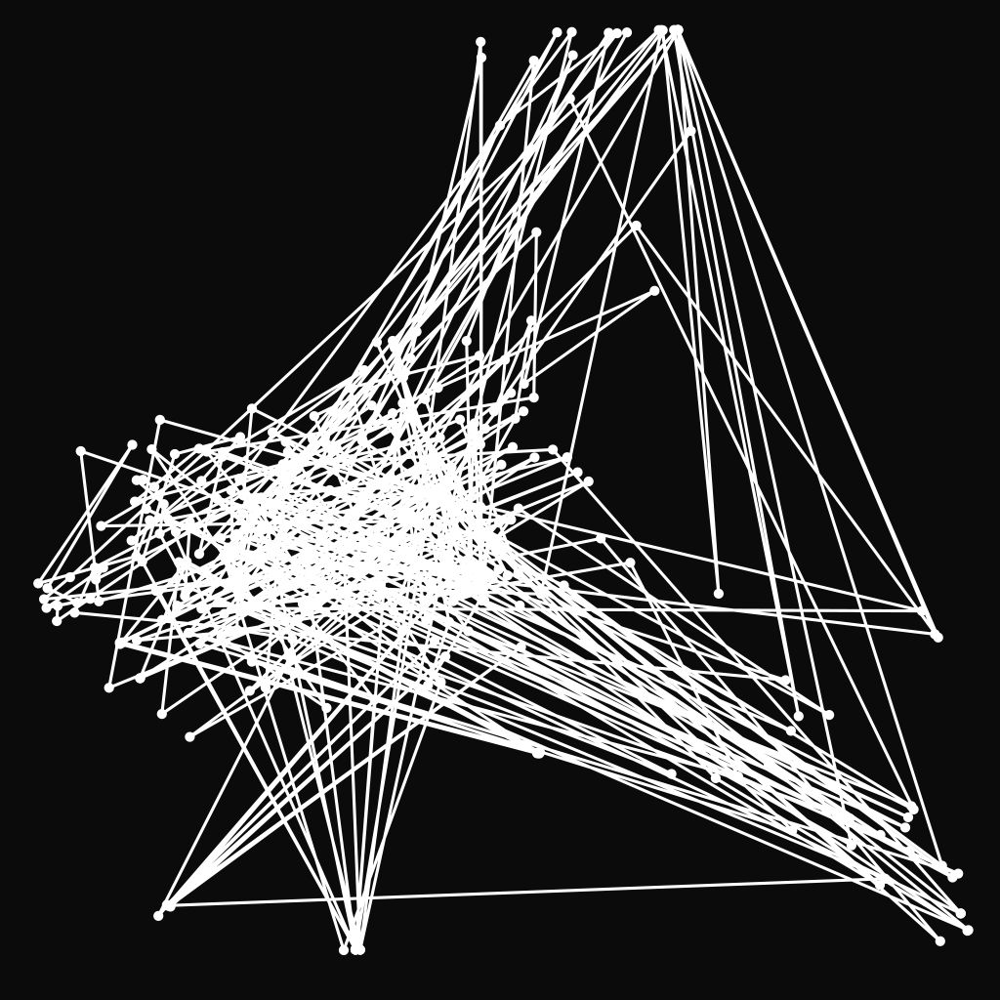

# lvs: a whole codebase in a few KB, every byte one lookup away

`lvs` gives an LLM a small map of a whole codebase (a few KB, however big the code) plus exact,
numbered pieces of the code to look up. The store keeps every byte, compressed about as small as zip,
and hands over any single piece on its own. So a model can know a codebase many times bigger than its
context window without reading it whole, and without ever decompressing anything itself.

Measured on two big Python codebases that no model had seen (66 blind runs, details in
[MILESTONE.md](https://github.com/devkancheti4-design/live-vector-space/blob/main/MILESTONE.md)):

| What was measured | Result |
|---|---|
| The map view alone (`map` plus a zoom into the main package, about 4.6 KB), 10 architecture questions per run | **100/100** right (raw code of the same size: 34/100) |
| Map + lookups, exact questions about codebases of 5-6 million tokens | **97.5%** right (468/480), for **2-4%** of the tokens a full read would take |
| A 6.2-million-token codebase, one session in a 1M-token window | **46/48** right in 111,501 tokens; **88.7%** of the code stayed compressed |
| Store size (reef, 14.5 MB of Python) | **30.7%** of the code (zip -9: 30.3%), any of 17,660 pieces readable alone, byte-exact |

## Install

Needs Python 3.14+ (for the built-in `compression.zstd`) and numpy.

```bash
pip install live-vector-space
```

The command it installs is `lvs`. For the latest code from GitHub instead:
`pip install git+https://github.com/devkancheti4-design/live-vector-space`

## Use

```bash
cd your-project
lvs build                  # the map and the compressed store, in .lvs/
lvs map                    # the whole codebase in a few KB: read this first
lvs files src/server       # zoom into a folder: its files, intents and piece numbers
lvs find timeout retry     # the numbered pieces that mention each word, with the line that matches
lvs get 812 813            # the exact code of those pieces
lvs rebuild /tmp/copy      # every file back, byte-exact
```

Lookups work from any subfolder (`lvs` finds `.lvs/` in a parent folder, the way git finds `.git`).
Run `lvs build` again after the code changes. `--store PREFIX` keeps several maps apart. Folders that
are never the project's own code (hidden folders, `venv`, `site-packages`, `node_modules`, `build`,
`dist`) are skipped; `--exclude NAME ...` skips more.

## Give it to an AI agent (MCP)

`lvs mcp` is a Model Context Protocol server over stdio, with five tools: `map`, `files`, `find`,
`get` (read-only lookups in the compressed store) and `build` (make or refresh the store). It tells
the agent to read the map first, then find and get only the pieces it needs.

With Claude Code, from your project folder:

```bash
claude mcp add lvs -- lvs mcp --root "$PWD"
```

Any other MCP client takes the same command in its config:

```json
{"mcpServers": {"lvs": {"command": "lvs", "args": ["mcp", "--root", "/path/to/your-project"]}}}
```

## Watch code live

```bash
lvs live path/to/file.py   # every statement as a vector in 3-D space, redrawn on each save
```

## How it works

- **Numbered exact pieces.** Each file is split at its natural joints (functions, classes, sections)
  into pieces numbered across the whole codebase. Joined in order, they rebuild every file byte for byte.
- **The store.** Every piece is compressed with zstd and a dictionary shared by all pieces, so the whole
  store is about as small as zip, yet any one piece unpacks on its own in an instant.
- **The map.** Folders and files with sizes and one-line intents, plus the code's shape: every statement
  becomes a point in a 3-D cube, and the points gather into cores of similar code, each with its words
  and its pieces. The map stays a few KB at any size (2.1 KB for reef's 14.5 MB of code), and `files`
  zooms in, page by page.
- **The word index.** `find` goes from words to piece numbers and shows the line that matched, so the
  model reads only the pieces it needs.

## Tests

```bash
python3 -m unittest discover -s tests
```

## License

GNU Affero General Public License v3.0 or later (AGPL-3.0-or-later); see [LICENSE](https://github.com/devkancheti4-design/live-vector-space/blob/main/LICENSE).

# The research behind it

Watch a Python file live, as vectors in 3-D space, plus a set of experiments on
squeezing code into shapes and maps that an LLM can read cheaply. The scripts below are the
research versions; the `lvs` package in `src/lvs/` is the product built from them.



## What's here

| File | What it does |
|---|---|
| `live_vector_space.py` | Turns every statement of a Python file into a 1024-d token vector, projects them to 3-D with PCA, and serves a live browser view: a cube filled with 14,000 particles of random "fluid" that settle into the code's shape. It updates every time the file is saved. |
| `skeleton.py` | Squeezes a file into 8 labeled cores of similar statements (a position in the cube plus a few words each). |
| `shape_codec.py` | Stores the 3-D points on a 12-bit grid in the cube, tied to anchor shapes, and decodes a perfect copy. |
| `optimal_shapes.py` | Lets the points choose their own shapes (blob, line, curve, sheet) by bit count (minimum description length). |
| `code_map.py` | A cheap map of a file plus exact, numbered pieces an LLM can look up; rebuilds the file byte-exact. |

Generated outputs: `code_square.svg`, `square_vs_scrambled.svg`, `shape_map.svg`,
`optimal_shapes.html`, `optimal_shapes_control.html` (open locally in a browser),
`code_map.json` and `code_store.bin`.

## Run it

Needs Python 3 with numpy; `code_map.py` needs Python 3.14+ for the built-in `compression.zstd`.

```bash
python3 live_vector_space.py                      # live 3-D view of itself at http://localhost:8765
python3 live_vector_space.py path/to/other.py     # any other Python file
python3 live_vector_space.py --square square.svg  # save the square-minus-the-path picture
python3 skeleton.py --stats
python3 shape_codec.py --svg shape_map.svg
python3 optimal_shapes.py --html optimal_shapes.html
python3 code_map.py build
python3 code_map.py find fluid svg
python3 code_map.py get 50
```

Viewer controls: drag to rotate, scroll to zoom, hover or click a point. Keys: `H` shake the fluid,
`F` fluid on/off, `V` vectors, `P` code path, `L` labels, `T` table, `S` square, `Space` spin.

## What the experiments found

Measured on `live_vector_space.py` itself (52,552 bytes, 357 statements).

- **The shape alone doesn't carry meaning.** Swapping all 964 names and words for gibberish leaves the
  fingerprint identical (exactly, with unhashed word counts). Fresh models given only the shape's numbers
  scored 7/14 on a quiz about the program, the same as answering "no" to everything.
- **Words carry the gist cheaply.** The file's one-line intent plus the skeleton (about 750 bytes) scored
  12/14 on what the program does, but 0/4 on details.
- **A map plus numbered lookups is the sweet spot.** With the map and exact lookups by number
  (`code_map.py`), a fresh model scored 14/14 and 4/4, the same as reading the whole file, using about
  9,200 extra tokens instead of about 30,400, and reading 8 of the 80 pieces.
- **Compression.** The cube grid stores the 357 points in 1,609 bytes; shapes the points chose themselves
  (8 blobs) take 1,471. The cloud is a nearly round ball, so lines and sheets don't help here (on control
  data that really forms lines and a sheet they save 32%). An exact copy of the code needs about 16 KB
  (brotli); numbered pieces with a shared zstd dictionary take 24 KB, the price of reading any piece on
  its own.

Each LLM test was a single run on one file, so small score differences may be chance.
